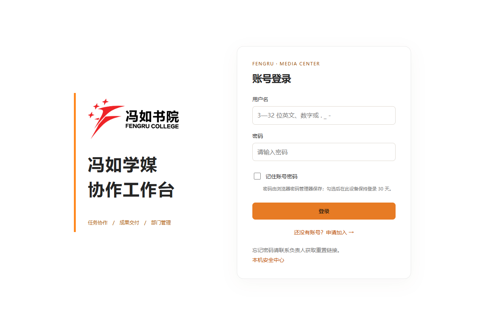
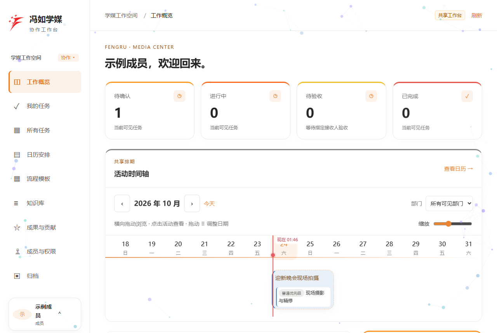
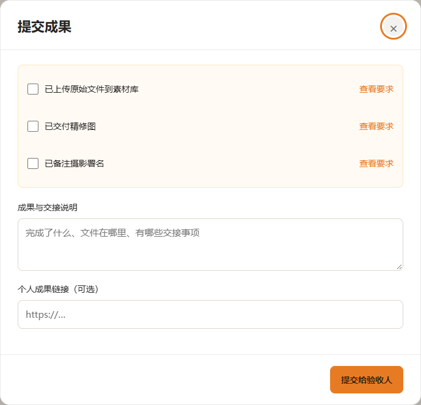
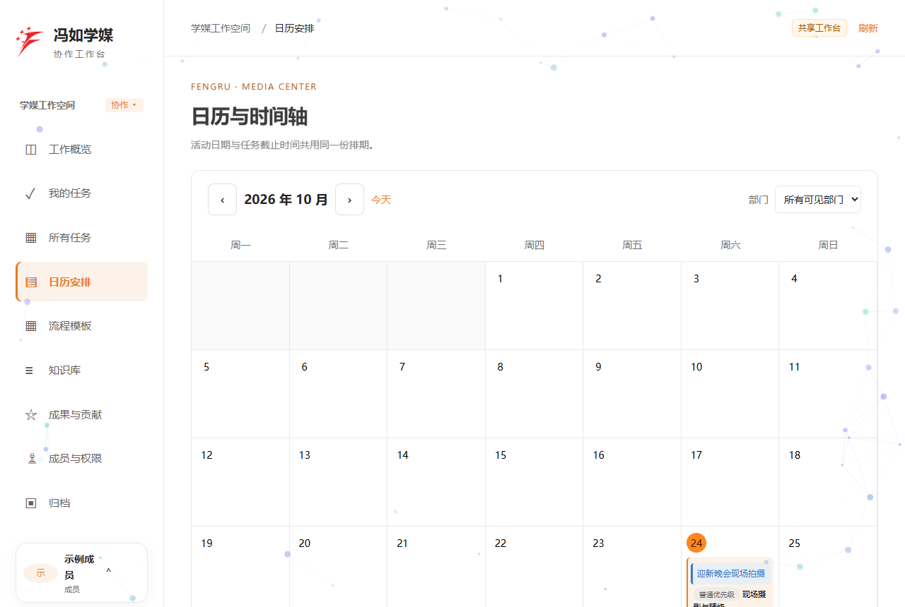
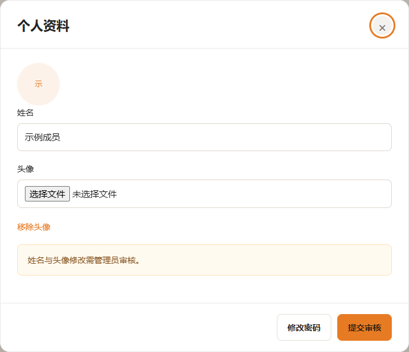
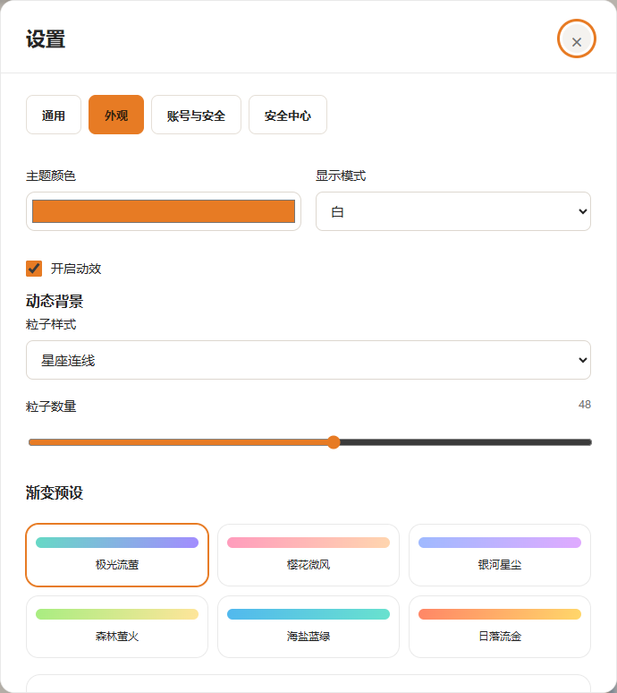
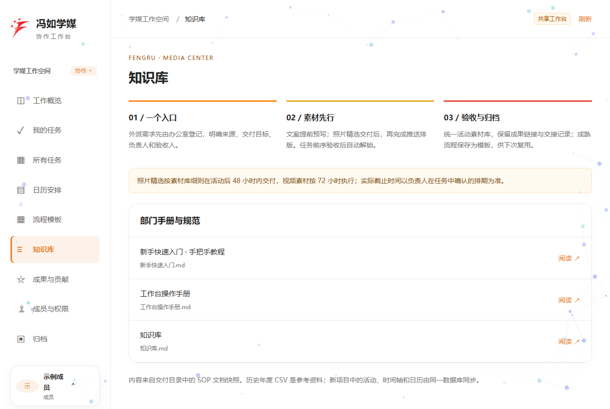

# 新手快速入门

> 这份教程按登录后能看到的界面顺序，带你走一遍工作台的基本用法。每步都有一个可以真敲真点的练习框，直接在这里操作，不碰真实数据。

## 先认识几个词

| 词 | 意思 |
| --- | --- |
| 活动 / 日程 | 一件事，比如一场拍摄或一次推送，有日期、地点、说明，下面挂着若干任务 |
| 任务 / 子任务 | 活动里具体要做的一件活，有负责人、验收人、截止时间 |
| 负责人 | 负责把这件事做完的人 |
| 验收人 | 检查成果是否合格的人，验收通过任务才算完成 |
| 接单 / 接受任务 | 负责人确认自己来做这个任务 |
| 提交成果 | 做完后写清楚成果在哪、交接给谁，交给验收人 |
| 验收 | 验收人确认成果合格，任务完成，积分入账 |
| 归档 | 已完成的活动、任务放进历史，不再出现在待办里 |
| 积分 | 任务验收后记给最终执行人，多人一起做会均分 |
| 模板 | 把固定流程存起来，下次建活动直接套用 |
| 前序依赖 | 有的任务要等前面任务验收后才解锁 |
| 素材库 | 活动统一放照片、视频、设计源文件的地方 |
| 工作空间 | 全体协作或某个部门，切换后看对应日程和分工 |

## 导航栏对应的页面

| 入口 | 图标 | 做什么 |
| --- | --- | --- |
| 工作概览 | ◫ | 登录后第一屏，看今天要做什么、活动时间轴、积分榜 |
| 我的任务 | ✓ | 接任务、反馈时间冲突、提交成果、配合验收 |
| 所有任务 | ▦ | 看全部活动和每个活动的分工流程 |
| 日历安排 | ▤ | 按月看活动和任务截止时间 |
| 流程模板 | ▦ | 把固定流程存成模板，下次直接复用 |
| 知识库 | ≡ | 看手册、规范，还有这份教程 |
| 成果与贡献 | ☆ | 查积分、验收记录和排名 |
| 成员与权限 | ♙ | 看组织架构、成员和在线状态 |

## 第 1 步：登录

用户名是 3—32 位英文字母、数字或 `. _ -`，密码至少 10 个字符。下面这个登录框和真实登录页一样，可以练一遍，不会连接真实账号。

@@sandbox login

真实登录时：打开 [工作台](https://fengrumedia.dpdns.org)，输入用户名和密码，勾选「记住登录」后点登录。

## 第 2 步：看工作概览

顶部四张卡片是待确认、进行中、待验收、已完成的任务数量。「需要处理」列出跟你有关、还没完成的任务。下面练一下：点开一个任务看看详情。

@@sandbox overview

## 第 3 步：接任务和交成果

点左侧 [我的任务](view:tasks)，能看到你负责或验收的任务。点开任务看截止时间、交付要求和验收人，先「接受任务」，做完后「提交成果」并写清交接说明。下面按这个顺序练一遍。

@@sandbox task

## 第 4 步：新建一个日程

负责人或管理员在「工作概览 / 所有任务」点「＋ 新建活动」建日程。正式环境只有负责人能建，下面这个练习谁都能建，不会写入真实数据。填个名称和日期，点「创建日程」。

@@sandbox event

## 第 5 步：看日历

点左侧 [日历安排](view:calendar)。日历里每个方块是活动或任务，点一下能看详情；下面的时间轴可以左右拖动、缩放。先在这个练习里点一个有圆点的日期。

@@sandbox calendar

## 第 6 步：改头像和资料

点右上角你的名字，或左下角「个人资料」。可以换头像、改姓名，提交后要管理员审核。这里可以真的选一张本地图片试试预览。

@@sandbox profile

## 第 7 步：调外观

点右上角名字，再点「设置」。能改中文／English、字号、主题色和深浅色。拖动下面的滑块和颜色，卡片会跟着变。

@@sandbox appearance

## 第 8 步：用知识库和安全中心

点左侧 [知识库](view:sop)，手册、规范都在这。界面异常或断网时，到「设置 → 安全中心」做本机检查。下面点一下「检查并修复」看看会返回什么。

@@sandbox safety

## 常见问题

| 问题 | 怎么办 |
| --- | --- |
| 忘记密码 | 找负责人要重置链接，链接 24 小时内有效，只能用一次 |
| 任务显示「待确认」 | 说明刚派给你，点开详情点「接受任务」 |
| 不能提交成果 | 先确认已经接单，检查项都勾了，说明也写了 |
| 页面提示「当前内容只读」 | 断网后进入只读快照，恢复网络后点「重新检查」 |
| 改了头像没变 | 要管理员审核通过才生效 |

## 几点提醒

1. 接单后按时交，提交时写清「成果在哪、交接给谁」。
2. 照片、视频、设计素材统一放活动素材库，保留署名和源文件。
3. 流程跑顺了就存成模板，下个活动直接复用。

看完可以先打开 [所有任务](view:activities) 逛一圈，或者回到 [工作概览](view:overview) 开始第一个任务。
